# 🎙️ Speech Emotion Recognition using LSTM (TESS Dataset)

Classifies human emotion from speech audio. MFCC features are extracted with **Librosa** and fed to an **LSTM network** (Keras / TensorFlow) that predicts one of 7 emotions.

**Possible applications:** call-centre analytics, customer-experience monitoring, voice assistants, wellbeing tools, human–computer interaction.

---

## 🎯 Emotions Detected

`angry` · `disgust` · `fear` · `happy` · `neutral` · `ps` (pleasant surprise) · `sad`

## 📂 Dataset

**TESS – Toronto Emotional Speech Set**: WAV clips from 2 female speakers (OAF and YAF) saying "Say the word ___" in 7 emotions.
In this run the loaded dataframe held **5,600 files (800 per emotion)**.

## 🛠️ Tech Stack

Python · Librosa · NumPy · Pandas · Matplotlib · Seaborn · Scikit-learn · TensorFlow/Keras · Google Colab

## ⚙️ Workflow

1. Load file paths and extract the emotion label from each filename
2. Explore waveforms and spectrograms for each emotion
3. Extract 40 MFCCs per clip (3 s, 0.5 s offset), averaged over time → input shape `(5600, 40, 1)`
4. One-hot encode labels → `(5600, 7)`
5. Train the LSTM: 50 epochs, batch size 64, `validation_split=0.2`
6. Plot accuracy and loss curves

## 🧠 Model Architecture (305,799 trainable parameters)

```
LSTM(256) → Dropout(0.2) → Dense(128, ReLU) → Dropout(0.2)
          → Dense(64, ReLU) → Dropout(0.2) → Dense(7, Softmax)
```
Loss: categorical cross-entropy · Optimiser: Adam · Metric: accuracy

---

## 📸 Screenshots

### Dataset preview
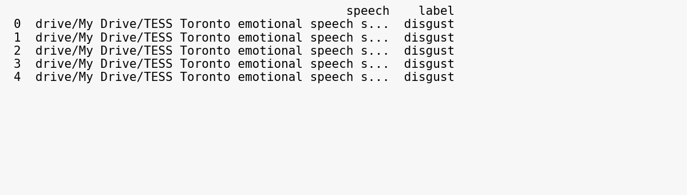

### Class distribution
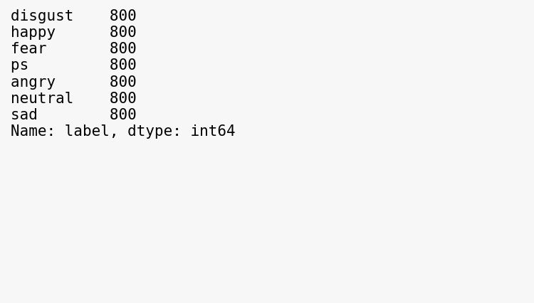

### Waveforms and spectrograms

| Emotion | Waveform | Spectrogram |
|---------|----------|-------------|
| Angry | 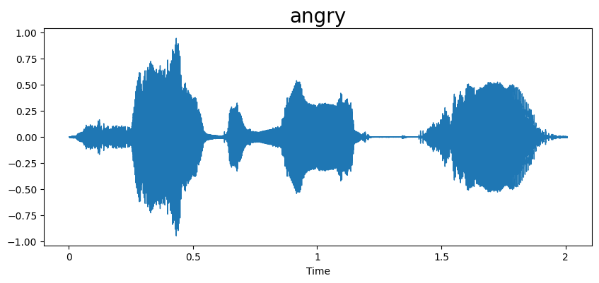 | 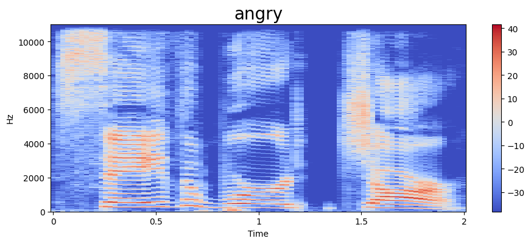 |
| Disgust | 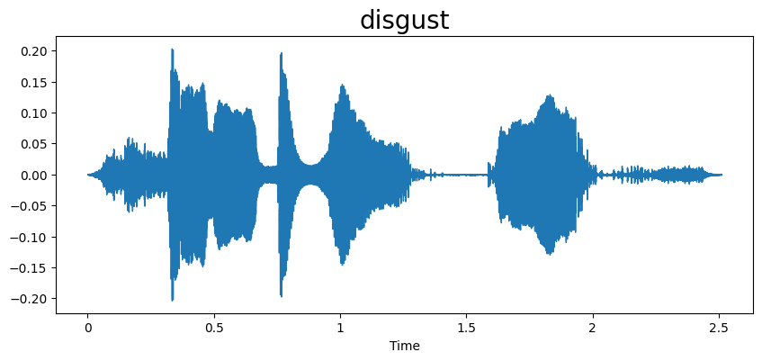 | 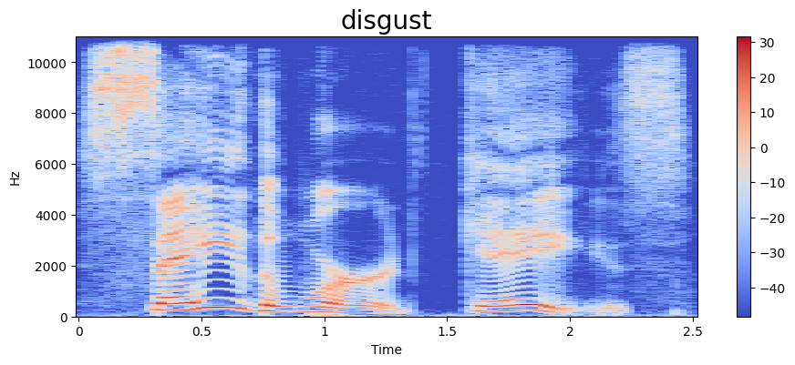 |
| Fear | 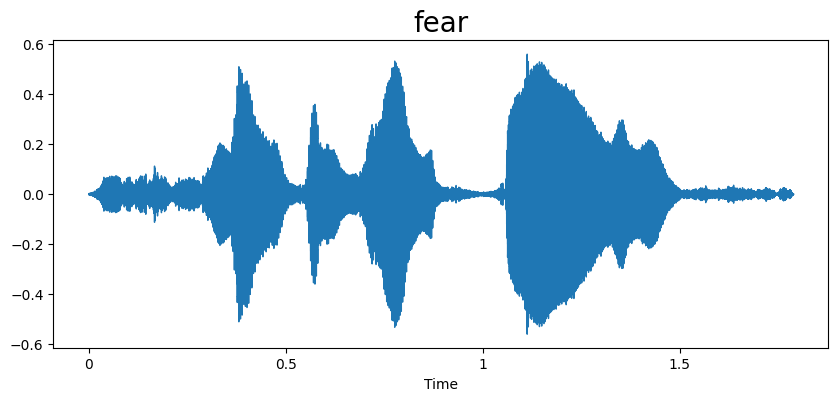 | 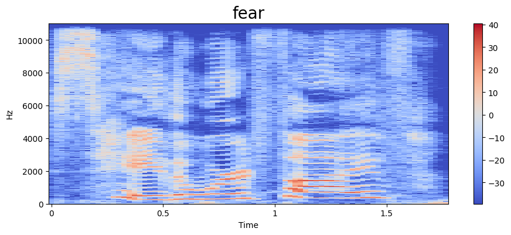 |
| Happy | 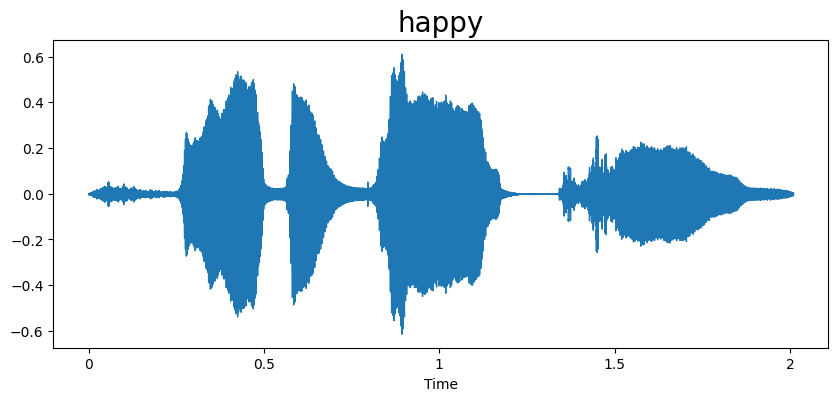 | 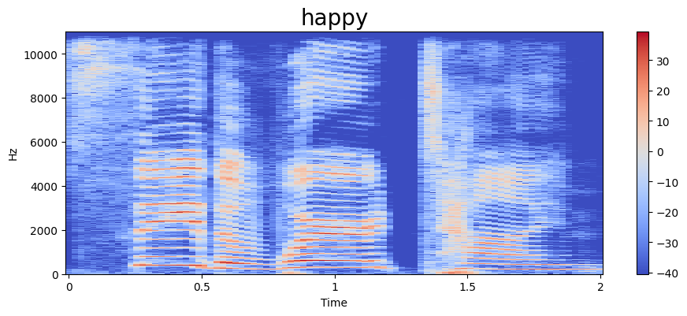 |
| Neutral | 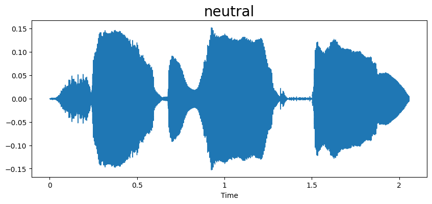 | 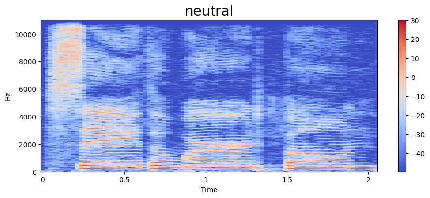 |
| Pleasant surprise | 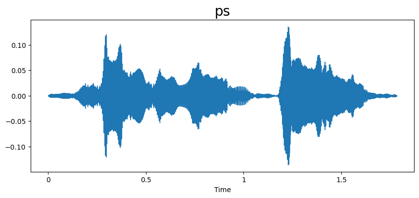 | 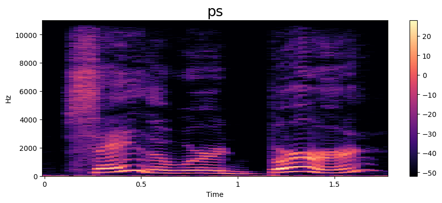 |
| Sad | 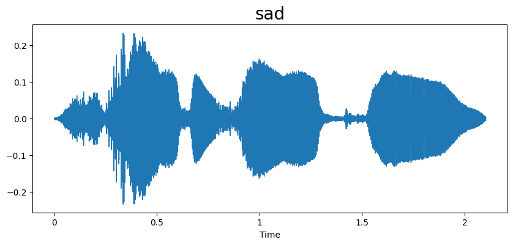 | 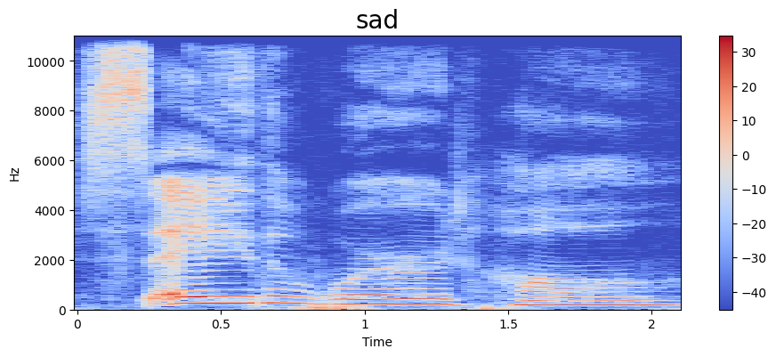 |

### Model summary
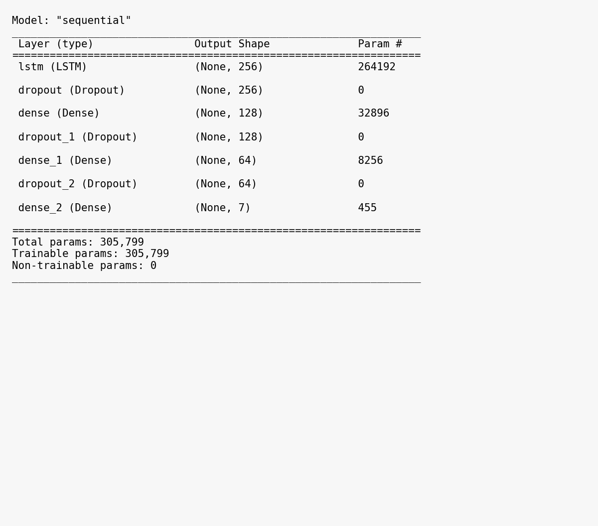

---

## 📈 Results

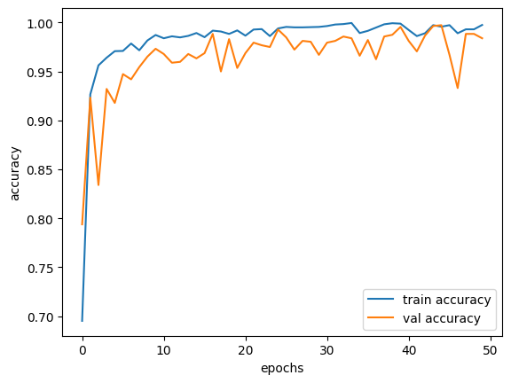
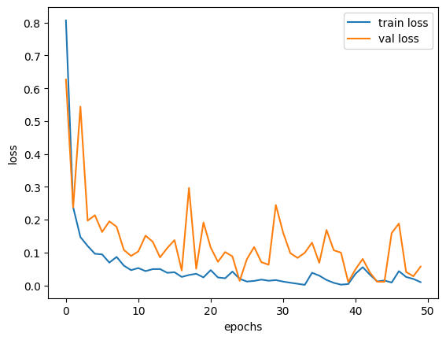

| Metric | Training | Validation |
|--------|----------|------------|
| Accuracy (epoch 48) | 99.31% | 98.84% |
| Loss (epoch 48) | 0.0256 | 0.0407 |
| Best validation accuracy (epoch 45) | 99.58% (train) | **99.73%** |

Epoch 1 reached 69.5% training / 79.4% validation accuracy; training accuracy passed 99% by about epoch 25.

### Observations
- The model learns quickly: over 92% validation accuracy after only 2 epochs.
- Validation accuracy is noisy between epochs (dips to about 93% around epochs 45–47) but stays in the high 90s.
- Training and validation curves are very close, which is unusually good for emotion recognition. This is partly because TESS is clean, acted studio speech with only two speakers.
- **Caveat:** the dataframe contains 800 clips per emotion, twice the 400 expected in TESS. If the dataset folder was copied twice, the same clips can appear in both training and validation, which inflates these scores. A speaker-independent test (train on one speaker, test on the other) would give a more realistic estimate.

---

## 🚀 How to Run

```bash
git clone https://github.com/<your-username>/<your-repo>.git
cd <your-repo>
pip install -r requirements.txt
```
1. Download TESS and place it in your Google Drive (or local folder)
2. Update the path in the notebook: `os.walk('drive/My Drive/TESS Toronto emotional speech set data')`
3. Open `speechemotion.ipynb` in Jupyter or Google Colab and run all cells

## 🔮 Future Improvements

- Remove duplicate files, use a stratified train/test split, and report a confusion matrix plus precision, recall and F1 per emotion
- Speaker-independent evaluation
- Data augmentation (noise, pitch shift, time stretch)
- Richer features (chroma, mel-spectrogram) and CNN / CNN-LSTM models
- Test on RAVDESS, CREMA-D or SAVEE
- Real-time demo app with Streamlit or Flask

## 📁 Repository Structure

```
├── speechemotion.ipynb
├── speechemotion.py
├── requirements.txt
├── README.md
└── images/   (16 PNG files used by this README)
```

## 👤 Author

**Nujumniza Shanavaz**: MSc Computer Science (Distinction), University of East London

## 📄 Licence

MIT. The TESS dataset has its own licence terms.
